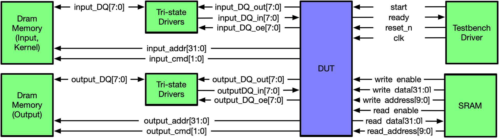
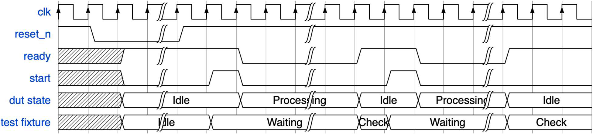
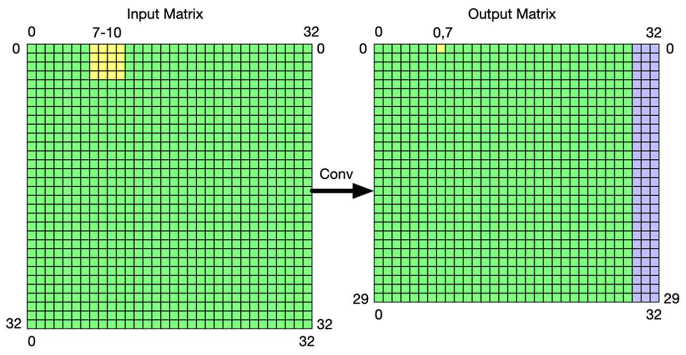

# CNN Convolution Pipeline (1024×1024 Input, 4×4 Kernel)

ECE 464, Fall 2025 — NC State University

A hardware 4×4 convolution engine that reads a 1024×1024 image and a 4×4 kernel from
external DRAM, computes the convolution with a serialized signed multiply-accumulate
datapath, and streams saturated 8-bit results back to DRAM using burst transactions. The
controller is a multi-phase FSM that sequences kernel load, input-window buffering, MAC
computation, and output writeback, reusing the same control flow for every window
position across the full image.

Full write-up with results and the datapath/FSM diagrams: [`Project_report/report.pdf`](Project_report/report.pdf).

## Overview
- [Design Summary](#design-summary)
- [Interface](#interface)
- [Memory Layout](#memory-layout)
- [Results](#results)
- [Decompress](#decompress)
- [Start Designing](#start-designing)
- [Synthesis](#synthesis)
- [Appendix](#appendix)

## Design Summary

Convolution is computed by sliding the 4×4 kernel across the input and, at each position,
computing:

$$Y(i,j) = \sum_{m=0}^{3}\sum_{n=0}^{3} X(i+m,\, j+n) \cdot K(m,n)$$

This implementation uses the fixed 4×4 kernel:

$$K = \begin{bmatrix} 1 & 0 & -1 & 0 \\ 1 & 0 & -1 & 0 \\ 1 & 0 & -1 & 0 \\ 1 & 0 & -1 & 0 \end{bmatrix}$$

The 1024×1024 input produces a 1021×1021 convolution output. Internally the accumulator
uses 20-bit values to absorb overflow, and the final result is truncated (clamped) to a
signed 8-bit value before being written back to DRAM.

**Datapath.** The entire 4×4 kernel and the current 4×4 input window are held in
locally buffered registers to avoid repeated DRAM accesses. A single signed MAC unit
iterates through the sixteen kernel/input products sequentially, accumulating partial
sums over multiple cycles per output pixel. This trades cycle count for a much smaller,
simpler datapath than a fully parallel MAC array.

**Controller (FSM).** After `start`, the FSM loads the kernel with two burst reads,
then streams input tiles from DRAM two rows at a time to form the sliding 4×4 window.
During computation it drives kernel/input values into the MAC datapath, storing partial
sums across columns. Once a window's accumulation finishes, saturation logic clamps the
result and a burst write commits it to DRAM. Row/column counters advance the same control
flow across the entire image.

## Interface

The DUT talks to a DRAM-backed test fixture over a simple start/ready handshake plus a
burst-oriented SDR memory bus (`CMD`, `Address`, tri-stated `DQ`).



The test fixture treats the synchronous rising edge of `ready` as end-of-test:



## Memory Layout

DRAM is laid out as 64-bit (8-byte) little-endian words: the first 16 entries hold the
4×4 kernel weights, followed by the input matrix in row-major order. Output is written
back in row-major order; since the convolution output (1021×1021) isn't a multiple of 8,
each output row is zero-padded to the next multiple of 8 bytes so every row starts at a
modulo-8 address. For a 32×32 example input, that padding looks like:



The same scheme scales to the full-size matrices used here: 1021 output columns/rows pad
out to 1024.

## Results

| Metric | Value |
|---|---|
| Clock period achieved | 6 ns |
| Simulation total cycles (per test) | 78,937,758 |
| Total cell count | 4,019 cells |
| Total cell area | 6,659.044 µm² |
| Setup slack | 0.0009 |
| Hold slack | 0.0309 |

---

## Decompress
Once you have placed ```projectFall2025.tar.gz``` at desired directory. Launch a terminal at that directory and use the following command to tar.
```bash
tar xzf projectFall2025.tar.gz
```
You should find the unzipped project folder ```projectFall2025/```

## Start Designing
### Setup script

```projectFall2025/setup.sh``` is used to load Modelsim and Synopsys.

To source the script:
```bash
cd projectFall2025
source setup.sh
```
This script also enables you to <kbd>Tab</kbd> complete ```make``` commands

### Where the design lives

```projectFall2025/srcs/rtl/dut.sv``` is the top-level RTL implementation, with ports
already connected to the test fixture. The detailed directory layout is in the
**Appendix** below.

### How to set up the build environment
```bash
cd projectFall2025
source setup.sh
mkdir build
cd build
cmake .. --preset run
```

### How to compile the design

This project provides three main simulation targets:

- **dut** — Build and run the implementation
  - Synthesizable RTL
  - Must meet interface timing and support pipelining
  - Use this target to verify functionality, latency, and protocol compliance

- **golden** — Run the reference SystemVerilog model
  - Not pipelined and not synthesizable
  - Behavioral-only model used as a correctness oracle

- **sram** — Run the memory test suite
  - Demonstrates expected behavior for back-to-back commands
---

## How to run simulation targets

### Normal and Debug targets
There are two input types: normal and debug. Normal is the input the design is graded on; debug is smaller and meant for iterating quickly.

Configure for Normal input (1024x1024):
```
cd projectFall2025/build
cmake .. --preset run
```
Configure for Debug input (32x32, for convenience, not a design requirement):
```
cd projectFall2025/build
cmake .. --preset debug
```

### Run with Modelsim UI:
```bash
make vsim-dut
```
This builds `projectFall2025/srcs/rtl/dut.sv` and launches the testbench in ModelSim.

### Build the implementation (dut)
This command can be executed inside ModelSim.
```bash
make vlog-dut
```
The following command, executed in ModelSim, will reload, restart, and run all test cases after changes to the dut file.
```bash
make vlog-dut; restart -f; run -all
```

### Simulation
The simulation log file:
```
projectFall2025/build/sim/logs/result.log
```
The simulation output files:
```
projectFall2025/build/sim/outputs/output[0/1/2/3].dat
```

There is a do file for waveform setup: ```projectFall2025/do/waves.do```

In Modelsim:
```
do ../do/waves.do
```

### Run golden model with Modelsim UI
```bash
make vsim-golden
```
All other commands are the same as for the implementation (dut).

### Run memory behavior tests with Modelsim UI
```bash
make vsim-sram
```
Short example demonstrating the SRAM scratchpad's behavior.

### Configuring for individual tests
```bash
cmake .. --preset test<test_case>
make vsim-dut
```
`<test_case>` can be 0–5. Example, test case 2:
```bash
cmake .. --preset test2
make vsim-dut
```

### Configuring for all tests
```bash
cmake .. --preset run
make vsim-dut
```

### Configuring for individual/all debug cases
```bash
cmake .. --preset debug<test_case>   # 0-3
make vsim-dut
```
```bash
cmake .. --preset debug              # all debug cases
make vsim-dut
```

### Evaluation / headless testing
```
cd projectFall2025/build
cmake .. --preset run
make vsim-dut-c   # Runs the test in headless mode
```
Produces a results log — run this as a final check before synthesis.
```
projectFall2025/build/sim/logs/results.log
```

## Synthesis

From ```projectFall2025/build/```:
```bash
make synth
```
Default clock period is 10 ns. To synthesize at a different clock period:
```bash
cmake .. -DDC_CLOCK_PER=YYY.XX
make synth
```
Example, 4 ns:
```bash
cmake .. -DDC_CLOCK_PER=4.0
make synth
```

Timing and area reports: ```projectFall2025/build/synth/reports/```

## Appendix

### Directory Rundown

* ```projectFall2025/```
  * Contains the ```CMakeLists.txt``` used to compile and simulate the design
* ```projectFall2025/inputs/input[0/1/2/3/4/5].dat```
  * `.dat` files for the DRAM input/kernel memory content
* ```projectFall2025/outputs/output[0/1/2/3/4/5].dat``` (generated)
  * `.dat` files for the output DRAM content
* ```projectFall2025/srcs/rtl/```
  * All `.v`/`.sv` files compiled by ```make vlog-dut``` in ```projectFall2025/build/```
  * `dut.sv` is the top-level implementation
* ```projectFall2025/srcs/tb/golden_dut.sv```
  * Reference behavioral model; build with ```make vlog-golden```
* ```projectFall2025/Project_report/```
  * Full project report (datapath/FSM diagrams, results, discussion)
* ```projectFall2025/synthesis/```
  * TCL scripts used to synthesize the design
  * Synthesis reports: ```projectFall2025/build/synth/reports/```
  * Synthesis logs: ```projectFall2025/build/logs/reports/```
  * Synthesized netlist: ```projectFall2025/build/synth/gl/```
* ```projectFall2025/srcs/tb/```
  * Test fixture (testbench) for the project
